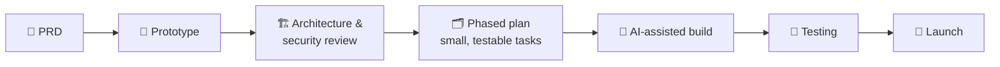

<!-- Animated banner -->

  

  
  
  
  
  

---

### 🚀 About Me

Software Engineer at **[AnoCloud](https://anocloud.in)**. I take products **from requirements to launch**, leading **3 engineers** and **AI coding agents**. AI writes much of the code. I own the decisions: what to build, how it's designed, whether it's secure, and whether it's ready to ship.

<table align="center">
  <tr>
    <td align="center" width="170"><h3>2+ years</h3>building full-stack products</td>
    <td align="center" width="170"><h3>2 products</h3>launched: Karmik &amp; Saarthi</td>
    <td align="center" width="170"><h3>1,400+ tests</h3>automated, across both products</td>
    <td align="center" width="170"><h3>4x GCP</h3>Google Cloud certifications</td>
  </tr>
</table>

- 🏢 Built products for AnoCloud and its clients across **retail, healthcare, finance, HR and sales**
- 🎓 B.Tech in Information Technology, RCC Institute of Information Technology, Kolkata (2024), CGPA 8.52/10
- 📍 Howrah, West Bengal, India · working remote
- 💬 Ask me about: **NestJS, Next.js, PostgreSQL, GCP, and shipping real products with AI agents**

---

### 🧭 How I Build

---

### 💼 Work at AnoCloud

#### 🧑‍💼 Karmik: HRMS for Indian companies
`NestJS` `Next.js` `Prisma` `PostgreSQL` `GCP`
- Designed a **53-screen prototype** for 4 roles (Founder, HR, Manager, Employee) and the system architecture
- **Two-step payroll** (HR prepares, Founder approves) processes **500 employees in under 30 seconds**; payslips sent automatically
- **Self-service onboarding links** replace paper forms; exits are checklist-driven with automatic relieving letters
- Launched with **610 backend + 188 browser tests** passing; 2FA, role-based access, masked ID and bank data

#### 📨 Saarthi: AI-assisted sales outreach platform
`NestJS` `Next.js` `Prisma` `PostgreSQL` `Groq`
- **Warm-up gate** (visit, like, comment) unlocks a connection request only after real engagement
- **AI message drafts** in 3 angles with brand-voice checks, and **a human approves every message**
- Follow-up reminders at 3, 7 and 15 days; 2FA, RBAC, rate limits and an audit trail; **700+ tests**

#### 🛒 Retail Home Delivery Platform (retail chain client)
`NestJS` `Next.js` `Flutter` `PostgreSQL` `AWS`
- Built the **POS sync service** (checkpoint/resume, selective repair), syncing store sales every 20 min; holds **3.6M+ receipts**
- Daily **SAP stock snapshots** and KPI queries (sales, stock-outs, supplier fill rates) for business dashboards

#### 🏥 More client work
- **[Hospital Visitor Tracking System](https://github.com/Anup1603/HVM_Backend)**: QR gate passes with visitor photos for multi-branch hospital chains
- **Multi-tenant Invoice Platform**: GST invoicing with separate data per company, used by **10+ companies**

Work code is private. Happy to walk through the design and decisions in an interview.

---

### 🧩 Personal Projects

| Project | Stack | What it does |
| ------- | ----- | ------------ |
| 🤖 [AI-Powered LinkedIn Content Assistant](https://github.com/Anup1603/AI-powered-LinkedIn-Content-Assistant) | NestJS, Next.js, Prisma, Gemini | Generate, edit, schedule and publish LinkedIn posts from a central knowledge base, with a provider-agnostic AI layer |
| 🏠 [Tenant Management System](https://github.com/Anup1603/TMS) | MERN, JWT | Property and tenant management portal with secure access |
| 📝 [NoteZipper](https://github.com/Anup1603/Note_Zipper_Frontend) | MERN, JWT | Note management app with secure login and full CRUD |

---

### 🛠️ Tech Stack

| | |
| --- | --- |
| **🤖 AI & LLMs** |  AI coding agents · spec-driven development · AI code review · prompt engineering · human-in-the-loop AI |
| **💻 Languages** |  TypeScript · JavaScript · Java · C++ · Dart · SQL |
| **🌐 Frontend & Mobile** |  React · Next.js · Redux Toolkit · Tailwind CSS · shadcn/ui · Material UI · Flutter · React Native |
| **⚙️ Backend** |  Node.js · NestJS · Express · Prisma ORM · Zod · Swagger / OpenAPI docs · REST APIs · WebSockets (Socket.IO) |
| **🗃️ Databases** |  PostgreSQL · MySQL · MongoDB · Redis |
| **☁️ Cloud & DevOps** |  GCP (Cloud Run, Cloud SQL, Compute Engine) · AWS (S3, SES, SNS) · Docker · Nginx · CI/CD · Git · Linux |
| **🧪 Testing & Security** |  Playwright · Vitest · Jest · Postman · end-to-end testing · UAT · RBAC · JWT · 2FA |
| **🧰 Tools** |  VS Code · Figma |
| **📐 Product & Delivery** | Interactive prototyping · system design · security review · phased delivery · team leadership |

---

### 🏅 Google Cloud Certified

  
  
  
  

---

### 📈 GitHub Activity

  
  

  

  

